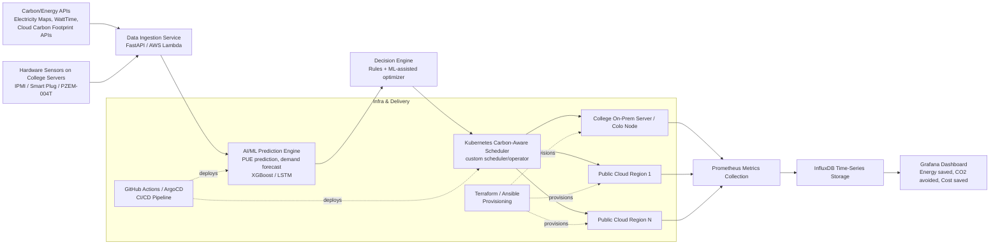
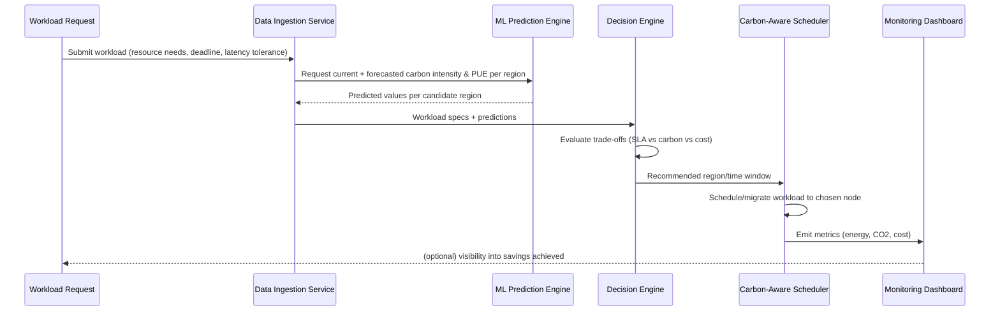

# Complete Project Context — GreenColo / Cloud-Driven AI System for Data Center Sustainability
**Purpose of this document:** Full context of everything discussed and decided so far, so this can be shared with another AI chat and continued without losing information. This supersedes the earlier handoff document — it includes everything from the original idea through the actual PBL portal submission.

---

## 1. Project Identity (Final, as submitted)

- **Institution:** MIT Art, Design & Technology University, Pune — School of Computing
- **Academic Year:** 2026–27
- **Group ID:** TYCC106
- **Team Name:** CloudGen
- **Guide code shown on PBL portal:** M126 (note: earlier physical PBL Monitoring Sheet listed guide as Prof. Dr. Abhishek M. Dhone — user was advised to confirm M126 refers to the same guide)
- **Student (submitter):** Rishabh Kankariya, ADT25SOCBD129
- **Event:** "Ideaspark" Poster Presentation — **10th August** (guide approval mandatory before poster display)
- **Faculty instruction received:** The project must explicitly reflect a Cloud component in the title/problem statement (e.g., "Cloud-based," "Cloud-driven," "Cloud-assisted"). Projects should be made unique/novel enough to be copyrightable.

### Final Project Title (submitted)
```
A Cloud-Driven AI System for Real-Time Energy & Carbon-Aware Optimization in Hybrid Colocation Data Centers
```

### PBL Portal Form — Final Submitted Values
- **Type:** Hybrid
- **Technology Bucket (only 1 selectable on this particular form):** Cloud Computing
  *(Earlier, on a different multi-select technology screen, 6 boxes were correctly checked: DevOps, Artificial Intelligence (AI), Machine Learning (ML), Data Science & Analytics, Internet of Things (IoT), Cloud Computing — Deep Learning and Big Data were correctly left unchecked since the project doesn't use deep neural nets as baseline or big-data-scale processing.)*
- **Domain:** Environment & Sustainability *(chosen over "Energy & Power" — reasoning: must match the original problem statement's own tag posted by Dr. Mansi Bhonsle, since "Domain" reflects sector/impact area, not tech stack; the tech stack is already captured elsewhere)*
- **Status after submission:** PENDING — awaiting mentor/guide review

### Final Problem Description (short version, submitted to fit field limits)
```
Colocation data centers consume massive electricity and contribute significantly to IT-sector carbon emissions, yet most hybrid cloud systems treat every server, region, and hour of power as equal, missing clear opportunities for greener, cheaper operation.

This project builds a Cloud-Driven AI System that monitors real-time electricity use, live grid carbon intensity, and cost, then uses machine learning to predict energy efficiency (PUE) and automatically schedule workloads between on-premise college servers and public cloud resources — always choosing whichever is cleanest and most efficient at that moment.

Unlike simulated approaches, this system uses genuine live data: real power readings from hardware sensors on college servers, real-time carbon intensity from a live API, and real electricity costs from actual tariff rates — all orchestrated through Kubernetes and deployed using DevOps practices (Terraform, CI/CD, Prometheus/Grafana).

The result is a practical, measurable solution for reducing energy waste and carbon footprint in colocation environments while enabling sustainable, scalable IT growth.
```

### Longer Problem Description (drafted first, kept as backup/reference — not the one submitted)
```
Data centers and colocation facilities are among the fastest-growing consumers of electricity worldwide, making energy efficiency and carbon reduction a critical challenge for the IT industry. While hybrid cloud adoption offers a major opportunity to optimize how and where computing workloads run, most existing solutions treat every server, region, and hour of electricity as equal — missing the chance to shift work toward genuinely cleaner and more efficient options.

This project proposes a Cloud-Driven AI System for Real-Time Energy and Carbon-Aware Optimization in Hybrid Colocation Data Centers. The system continuously monitors real-time electricity consumption, live grid carbon intensity, and computing costs, then uses an AI/ML model to predict energy efficiency (Power Usage Effectiveness) and workload demand. Based on these predictions, a cloud-orchestrated scheduler automatically decides where and when each workload should run — shifting flexible, non-urgent tasks between our college's on-premise servers and public cloud resources (AWS/Azure/GCP) to whichever option is cleanest and most cost-efficient at that moment.

What makes this project unique is that it is grounded in genuine, live data rather than simulation alone. Actual power draw is measured directly from college lab servers using hardware sensors (IPMI/smart plug/PZEM-004T energy meter), real-time grid carbon intensity is pulled from a live carbon data API for our region, and electricity cost is calculated using the college's actual tariff rate. This live data feeds an AI prediction engine and a Kubernetes-based carbon-aware scheduler, with the entire pipeline provisioned and deployed using DevOps practices — Infrastructure-as-Code (Terraform), containerization (Docker/Kubernetes), CI/CD automation, and real-time observability dashboards (Prometheus/Grafana).

By combining cloud computing, artificial intelligence, IoT-based hardware monitoring, and DevOps automation into a single working system, this project demonstrates a practical, measurable path for colocation providers to significantly improve energy efficiency, reduce their carbon footprint, and scale their IT infrastructure sustainably — directly addressing the growing need for environmentally responsible digital infrastructure.
```

### Original Problem Statement (as assigned by faculty, unedited)
```
1. Data Centers: Colocation Solutions for Sustainability
Tags: Software | Environment & Sustainability | 🛠 Cloud Computing, AI etc.
Posted by: Dr. Mansi Bhonsle

Description:
Colocation solutions enhance IT sustainability through hybrid cloud optimization, enabling more efficient use of resources. Optimizing hybrid cloud environments allows colocation providers to significantly improve energy efficiency, contributing to the overall sustainability of IT operations. Beyond energy efficiency, colocation solutions provide access to renewable energy sources, allowing clients to reduce their carbon footprint and achieve their sustainability goals. The combined effects of hybrid cloud optimization and energy-efficient colocation contribute positively to IT sustainability efforts, making them a crucial component of modern data center strategies. The scalable nature of colocation solutions offers significant opportunities for businesses looking to expand their IT infrastructure while maintaining a commitment to sustainability. Leveraging these solutions allows companies to balance their growth and environmental responsibilities, ensuring long-term success in a rapidly evolving digital landscape.
```

---

## 2. One-Line Summary / Elevator Pitch
> "We're building an AI system that automatically shifts cloud computing workloads to wherever and whenever the electricity is cleanest and most efficient — making data centers more sustainable using real hardware-measured data, not just simulation."

---

## 3. Core Idea (What We're Building)

An AI-powered, cloud-driven system that:
1. Watches — continuously checks live electricity usage (from real hardware sensors on college servers) and live grid carbon intensity data
2. Decides — an ML model predicts energy efficiency (PUE) and demand, and a decision engine figures out the best time/place to run each workload
3. Acts — a Kubernetes-based scheduler automatically shifts workloads between the college's on-premise servers and public cloud (AWS/Azure/GCP), choosing whichever is cleanest/cheapest at that moment
4. Shows — a live dashboard displays real-time energy, cost, and CO2 savings

Key differentiator vs. typical student projects: **real, live data** (not simulated) — actual power readings from campus hardware + a real carbon-intensity API + actual electricity tariff rates.

---

## 4. Features

### Core Features
1. **Real-time carbon/energy data ingestion** — live grid carbon intensity (Electricity Maps API) + cloud provider carbon tools + internal server telemetry (CPU/GPU load, cooling power, temperature)
2. **AI/ML Prediction Engine** — predicts PUE using XGBoost/MLP (baseline) or optionally LSTM/BiGRU (stretch goal); forecasts workload demand; served via FastAPI
3. **Decision Engine (workload placement logic)** — rules-based + ML-assisted optimizer evaluating latency tolerance, deadlines, resource needs vs. predicted carbon/energy conditions
4. **Carbon-Aware Kubernetes Orchestration** — custom-extended K8s scheduler/plugin enforcing placement decisions across hybrid nodes
5. **Observability Dashboard** — Prometheus + Grafana, instrumented with OpenTelemetry, showing energy/CO2/cost savings live
6. **Infrastructure as Code** — Terraform (provisioning) + Ansible (config management of on-prem/college nodes)
7. **CI/CD Automation** — GitHub Actions/GitLab CI + ArgoCD (GitOps); example use case: scheduling non-urgent CI jobs during low-carbon windows
8. **Serverless event triggers** — AWS Lambda/Azure Functions for threshold-based migration triggers
9. **Hardware/IoT data collection layer** (added later in conversation) — real sensors on actual college servers feeding the pipeline live

### Optional / Future Features
- Reinforcement learning for continuous self-improving placement decisions
- Direct renewable energy procurement/matching (solar, wind availability) in scheduling logic
- Multi-tenant SLA support with configurable sustainability-vs-performance trade-offs
- Full ESG-aligned sustainability compliance/reporting module
- Possible future Google AI/Gemini-based natural-language assistant layer on the dashboard (not yet decided/built)
- True multi-vendor hybrid cloud (AWS + Azure/GCP together), beyond current single-provider + on-prem plan

---

## 5. Technology Stack (Final, as filled into the PBL portal's Technology Stack form)

**Frontend**
```
Grafana (dashboard/visualization), React (optional custom UI for demo)
```

**Backend**
```
Python, FastAPI
```

**Database**
```
InfluxDB (time-series data for live sensor/energy readings) — primary recommendation
PostgreSQL (optional, for structured/relational data like workload logs, config) — can be dropped to keep scope simple
```

**DevOps / Deployment**
```
Docker, Kubernetes, Terraform, GitHub Actions, ArgoCD, AWS / Azure / GCP
```

**Development Tools**
```
Prometheus (metrics collection), Postman (API testing), VS Code, Git/GitHub, ipmitool (hardware power monitoring), Electricity Maps API (carbon intensity data)
```

**AI / ML libraries**
```
scikit-learn, XGBoost (baseline); optional LSTM/BiGRU deep learning as a stretch goal
```

**Carbon/Energy Data APIs**
```
Electricity Maps API (primary — live carbon intensity, electricity mix, renewable %, carbon-free %)
WattTime API (secondary/optional — better US coverage than India, mentioned for comparison only)
```

**Note:** No database, frontend framework beyond Grafana, or authentication system had been finalized earlier in the conversation — these are now resolved above with InfluxDB/PostgreSQL and Grafana/React as of this document's writing. Authentication is still not discussed/decided.

---

## 6. Hardware & Real-Time Data Collection Plan (Key Addition Mid-Conversation)

### Why hardware was added
The user wanted to move beyond fully simulated data and instead collect **actual live data** from their college's own servers for electricity, cost, and CO2 — making the "hybrid" concept literal (college's own on-prem servers = one side of hybrid, public cloud = other side).

### Hardware options discussed (easiest → most involved)
1. **IPMI / iDRAC / iLO** (if college servers support it) — server management chips already report real-time power draw in watts; query via `ipmitool` or Redfish API; zero extra hardware needed, just requires network access/permission from IT
2. **Smart plugs** (TP-Link Kasa, Sonoff with Tasmota firmware) — expose a local API/MQTT reporting live wattage; good for a lab PC or small test server
3. **PZEM-004T energy meter + ESP32/Arduino** (~₹500–800) — AC energy meter module clamped around the power line, connected via ESP32 for WiFi reporting; gives live voltage, current, power (W), and cumulative energy (kWh); most hands-on hardware option
4. **PDU/UPS with SNMP** (if college server room has one, e.g. APC) — SNMP queries for real-time power draw per outlet; zero extra hardware, needs network access + permission

**Practical recommendation given:** likely won't get permission to touch production servers, so scope to 2–3 lab PCs or a small test server instrumented with a smart plug or PZEM sensor, standing in for the "colocation site" — feasible within a semester and still demonstrates the concept.

### Data source table (what's genuinely live vs. calculated)

| Metric | How live is it | Source |
|---|---|---|
| Electricity (power draw, kWh) | Fully real-time | Hardware sensor/IPMI/SNMP reading, polled every few seconds |
| Cost | Real, calculated | Live kWh × college's actual electricity tariff rate (MSEDCL — Maharashtra State Electricity Distribution Co.) |
| CO2 (grid carbon intensity) | Real, live API (not sensor-based) | Electricity Maps API — confirmed to deliver real-time carbon intensity data for 200+ countries/zones at hourly granularity, including India |

### Cost data — important limitation noted
India does **not** have an easy public real-time electricity price API for retail/college consumers (unlike EU/US day-ahead markets). Two options discussed:
- **Static tariff (recommended/simplest):** get the college's actual commercial electricity tariff rate from MSEDCL's bill or published tariff schedule; compute cost = live kWh × rate
- **Wholesale market reference (optional/stretch):** Indian Energy Exchange (IEX) publishes day-ahead market clearing prices on iexindia.com — not a clean free API, downloadable data only, useful as a bonus chart, not primary billed cost

### Updated end-to-end data pipeline
```
Your server (IPMI/smart plug/PZEM) → live watts, every few seconds
        × time → live kWh
        × MSEDCL tariff rate → live cost (₹)
        × Electricity Maps IN-WE carbon intensity (gCO2/kWh) → live CO2 (g)
→ all pushed into FastAPI ingestion service → stored in InfluxDB → visualized in Grafana
```

---

## 7. APIs — Full Reference (as compiled during conversation)

### Electricity Maps API (primary carbon data source)
- **Free tier:** access to carbon intensity of consumed electricity for one specific zone; live data for 200+ zones; hourly resolution
- **Academic bonus:** signing up with a college/institutional email (.edu-equivalent) grants automatic access to academic data — recommended to use MIT-ADT email
- **Sign up:** api-portal.electricitymaps.com → Free tier
- **India zone:** likely `IN-WE` (Western India, covers Maharashtra/Pune) — confirm exact code in their zone list/app before signup
- **Key endpoint (live carbon intensity):**
```
GET https://api.electricitymaps.com/v3/carbon-intensity/latest?zone=IN-WE
Headers: auth-token: YOUR_API_KEY
```
- **Other available signals (same API):** electricity mix (source breakdown — coal/solar/wind %), renewable percentage, carbon-free percentage, day-ahead price (Europe/US/Japan/Australia only, not India), total load
- **Sample Python code:**
```python
import requests

headers = {"auth-token": "YOUR_API_KEY"}
resp = requests.get(
    "https://api.electricitymaps.com/v3/carbon-intensity/latest",
    params={"zone": "IN-WE"},
    headers=headers
)
print(resp.json())  # {"zone": "IN-WE", "carbonIntensity": ..., "datetime": ...}
```

### WattTime API (secondary/optional)
- Strong for US grid data (marginal emissions, 5-min updates); patchier coverage outside the US
- Recommended only as a secondary/comparison source, not primary, for an India-based project

### Hardware-side data (no public API — local/custom)
- **IPMI:** `ipmitool sensor` or Redfish REST API — live power draw in watts
- **Tasmota-flashed smart plug:** `GET http://<plug-ip>/cm?cmnd=Status%208` — live power/voltage/current as JSON
- **TP-Link Kasa smart plug:** local API via `python-kasa` library
- **PZEM-004T + ESP32:** custom script reads sensor over serial, pushes JSON (`{"voltage":..., "current":..., "power":..., "energy_kwh":...}`) to your own FastAPI ingestion endpoint over WiFi — this part must be built, not a public API

---

## 8. System Architecture

### High-level flow (text)
```
Carbon/Energy APIs → Data Ingestion Service (Lambda/FastAPI)
        → ML/Decision Engine (containerized)
        → K8s Scheduler/Operator → routes workloads across regions/clusters
        → Prometheus/Grafana Dashboard ← metrics from all of the above
(Terraform provisions everything, GitHub Actions/ArgoCD deploys it)
```

### Mermaid — High-Level System Flow


### Mermaid — Workload Placement Decision Sequence


---

## 9. Literature Review / Research Papers Referenced

1. Gao, J., "Machine Learning Applications for Data Center Optimization," Google, 2014 — PUE prediction within ~0.4% error; used to guide real operational changes reducing cooling power ~40%
2. "Deep machine learning-based power usage effectiveness prediction for sustainable cloud infrastructures," ScienceDirect, 2022 — tests MLP, Resilient Backpropagation DNN, and Attention-based LSTM models
3. "PULSE: A modular framework for predictive energy efficiency in heterogeneous data centers," ScienceDirect, 2025 — combines deep-learning PUE prediction with a natural-language assistant
4. "Carbon emission-aware job scheduling for Kubernetes deployments," Journal of Supercomputing, Springer, 2023 — CO2-aware scheduling algorithm reducing total CO2 emission by ~1.3% vs default scheduler while preserving SLAs
5. Kannan, D. D., Trivedi, A., Srinivasan, D., "A Bidirectional Gated Recurrent Unit Model for PUE Prediction in Data Centers," IJCNN, 2025
6. Azure, "Kubernetes Carbon Intensity Exporter" and "Carbon Aware KEDA Operator" — GitHub open-source repos
7. Masselink, D., "Building a Carbon and Price-Aware Kubernetes Scheduler," Compute Gardener / ITNEXT, 2025 — cited ~18 metric tons CO2e avoided/month case study

## 10. Reference GitHub Repos (for inspiration/forking — not this project's own repo)
- `zemdom/carbon-aware-scheduling` — custom K8s scheduler distributing jobs to lowest-carbon servers/regions; includes carbon-footprint-data, power-measurement, power-model components
- `Azure/kubernetes-carbon-intensity-exporter` — lets K8s operators leverage WattTime/Electricity Maps carbon intensity data
- `Azure/carbon-aware-keda-operator` — extends KEDA autoscaling to cap replicas based on real-time carbon intensity
- Compute Gardener Scheduler — carbon- and price-aware secondary K8s scheduler; ~18 metric tons CO2e/month avoided in one cited case study
- GitHub topics to browse further: `carbon-aware-computing`, `kubernetes-scheduler`

**Suggested next step (not yet executed):** fork `zemdom/carbon-aware-scheduling` or Azure's carbon-intensity exporter, adapt for hybrid college-colocation simulation instead of bare-metal.

---

## 11. Career / Resume Framing (discussed, for reference)

- Frame resume bullets around measurable outcomes (e.g., "reduced simulated CO2 emissions by X%"), not just a tech list
- Bad: "Built a Kubernetes scheduler using Terraform and Python."
- Better: "Designed and deployed a carbon-aware workload scheduler on Kubernetes that dynamically shifts compute across regions based on real-time carbon intensity data, reducing simulated CO2 emissions by X% — using Terraform, Docker, Prometheus/Grafana, and a Python ML model."
- Career paths this supports: Cloud/DevOps Engineer, Site Reliability Engineer (SRE), Green/Sustainable Software Engineer (emerging niche, less saturated), MLOps
- Caution: interviewers will probe *why* specific architecture choices were made (e.g., why K8s scheduler vs. cloud-native autoscaler) — be ready to defend decisions, not just describe the stack

---

## 12. Deliverables Already Produced

1. **`Project_Synopsis_Sustainable_Colocation_Hybrid_Cloud.docx`** — full academic synopsis Word document: Title Page, Introduction, Problem Statement, Objectives, Literature Review, Proposed System/Methodology, Technology Stack table, Expected Outcome, Applications, Future Scope, References. Uses placeholder text (e.g., "[Your Name / Team Name]") that needs to be filled in.
2. **`Project_Context_Handoff.md`** — earlier version of this handoff document (now superseded by this file)
3. **PBL Monitoring Sheet answers** — draft content for every discussion row on the physical "First Interaction with Students" form (problem statement, real-world relevance, proposed solution, users, innovation, tech stack, modules, resources, dataset requirements, feasibility, risks, deliverables, learning outcomes, task distribution, tentative timeline)
4. **Actual PBL portal submission** — problem statement submitted live on the MIT-ADT PBL dashboard with Group ID TYCC106 / Team CloudGen; status PENDING as of this writing
5. **Message drafted to guide** — short note informing the guide the problem statement was updated per induction meeting instructions and is awaiting review

### Message sent to guide (for reference)
```
Good afternoon Sir,

I have updated our PBL problem statement on the dashboard as per the instructions from the induction meeting — the title now reflects "Cloud-Driven" and the description has been revised accordingly. The status currently shows "Pending" for your review.

Could you please check it whenever you get a chance? Let me know if any changes are needed.

Thank you, Sir.

Regards,
Rishabh Kankariya
Group TYCC106 (CloudGen)
```

---

## 13. Development Timeline (How This Conversation Evolved)

1. Uploaded original problem statement image → deep dive into 5 candidate project ideas → selected AI-driven hybrid cloud workload placement optimizer (+ PUE prediction)
2. Cloud/DevOps technology mapping requested and provided
3. Short summary generated
4. Research requested → GitHub repos and academic papers compiled
5. Resume/career framing discussed
6. Formal academic synopsis document (.docx) created
7. Plain-language mentor explanation prepared
8. Uploaded college PBL Monitoring Sheet (physical form) → all discussion rows drafted
9. First full context handoff document created (superseded by this one)
10. **New direction discussed:** using real hardware + live data from college servers instead of pure simulation — hardware options, data source table, cost/CO2 API limitations for India all worked out
11. APIs compiled in detail (Electricity Maps primary, WattTime secondary, hardware-local options)
12. Uploaded actual live MIT-ADT PBL portal screenshot (Group TYCC106, Team CloudGen, Guide M126) → filled in Project Title, Type, Technology Bucket, Domain, Problem Description for the real form
13. Faculty announcement received: project must reflect "Cloud" explicitly in title; Ideaspark poster event on 10th August; guide approval mandatory before poster display
14. Title iterated: "Cloud-Assisted" → "Cloud-Driven"/"Cloud-Orchestrated" alternatives discussed → finalized on "A Cloud-Driven AI System for Real-Time Energy & Carbon-Aware Optimization in Hybrid Colocation Data Centers"
15. Problem Description iterated: long version → shortened to a tighter 4-paragraph, ~140-word version for form character limits
16. Domain decision: Environment & Sustainability chosen over Energy & Power (to match original assigned PS tag)
17. Technology Bucket: only 1 selectable on that particular form field → Cloud Computing chosen (confirmed as correct choice, consistent with faculty's "Cloud" instruction); separately, a different multi-select technology screen had 6 correctly checked (DevOps, AI, ML, Data Science & Analytics, IoT, Cloud Computing)
18. Actual form submitted — screenshot confirmed "Problem statement updated successfully," status PENDING
19. Message to guide drafted
20. Technology Stack form (Frontend/Backend/Database/DevOps/Dev Tools) filled in with final stack recommendations (Grafana+React, FastAPI, InfluxDB+PostgreSQL, Docker/K8s/Terraform/GitHub Actions/ArgoCD, Prometheus/Postman/etc.)
21. **This document requested** — full consolidated handoff for sharing with another AI chat

---

## 14. Open Items / Not Yet Decided or Built

- Nothing has been coded yet — this is still entirely at the planning/proposal/academic-submission stage
- No GitHub repository created for this project yet (only reference repos identified)
- No authentication system designed
- Exact India zone code for Electricity Maps not 100% confirmed (needs checking in their live zone list/app — likely `IN-WE` for Western India/Maharashtra)
- Permission not yet secured from college IT/server admin to physically instrument servers (flagged as the main real-world blocker)
- Poster for Ideaspark (Aug 10) not yet built
- Guide approval on the problem statement still PENDING at time of writing
- Guide identity discrepancy (M126 vs. Prof. Dr. Abhishek M. Dhone) not yet confirmed as the same person
- No demo, screenshots of a working system, or blog post written yet (blog was mentioned as a future goal earlier in conversation but not pursued further yet)

---

## 15. Immediate Next Steps (as of this document)

1. Wait for/follow up on guide approval of the submitted problem statement
2. Confirm guide identity (M126)
3. Build the Ideaspark poster (architecture diagram, problem statement, tech stack, expected outcome) — offered but not yet executed
4. Get permission from college IT/server admin for hardware access (IPMI/SNMP/sensor installation)
5. Confirm exact Electricity Maps India zone code and sign up (ideally with MIT-ADT academic email for academic access tier)
6. Get the MSEDCL commercial tariff rate from the college's actual electricity bill
7. Start building: FastAPI ingestion service, InfluxDB setup, first hardware sensor reading script
